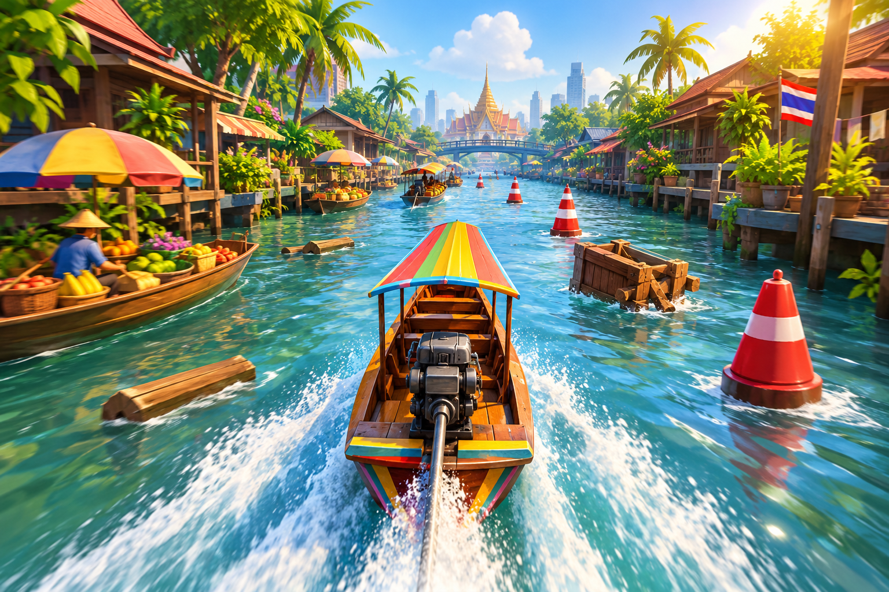

# Turbo Boats

> **An endless river runner in development.** Take the helm of a Thai longtail boat, find a clear path through changing waterways, and keep the hull intact.

Concept art for the visual direction. The Unity river and player boat use separate procedural, low-poly runtime geometry; the concept image is not a game texture or model.

**Status:** Prototype &nbsp; · &nbsp; **Engine:** Unity 6000.6.7f1 &nbsp; · &nbsp; **Language:** C# &nbsp; · &nbsp; **Targets:** WebGL build produced; Android/iOS setup in progress

Turbo Boats is a single-player boat runner set across Thai inland rivers. Steer continuously to avoid floating hazards, collect river tokens, and manage hull damage as the scenery moves from city canals to markets, rice fields, and forest waterways.

## Gameplay

- **Steer through the river:** guide the boat smoothly across the available water.
- **Boost:** tap **W / ↑** on keyboard or the **BOOST** touch button for a 1.75× speed burst lasting two seconds; it recharges over five seconds.
- **Avoid hazards:** a bow impact ends the run; a stern scrape damages the hull and produces smoke.
- **Recover:** collect green health packs to restore a hull point.
- **Travel farther:** navigate procedural river sections and collect tokens along the route.

The prototype starts with three hull points. The HUD displays distance, tokens, remaining hull, and the current river zone.

### Controls

| Device | Steer | Speed boost | Restart after a crash |
|---|---|---|---|
| Keyboard | Hold **A/D** or **←/→** | Tap **W** or **↑** | **R** or the on-screen button |
| Gamepad | Move the left stick horizontally | — | On-screen button |
| Touchscreen | Hold **STEER LEFT/RIGHT** pads or drag anywhere | Tap **BOOST** | **Restart** button |

## Run in Unity

1. Open the repository folder in Unity Hub using **Unity 6000.6.7f1**.
2. Open `Assets/Scenes/CanalRun.unity`.
3. Press **Play** in the Unity Editor.

If the scene file is missing, the editor bootstrap can create the scene. The repository includes a checked-in WebGL build under `Builds/WebGL`; serve that folder over HTTP to run it in a browser. Use **Turbo Boats > Build > WebGL** in Unity to rebuild it. Android and iOS development build commands are included, but their Unity platform modules are not installed in this environment. See [platform build status and delivery notes](docs/PLATFORM_BUILDS.md).

## Project status

### Implemented prototype systems

- Continuous boat steering for keyboard, gamepad, and touchscreen input.
- Procedurally spawned river sections with four distinct canal, market, paddy, and forest visual themes.
- Procedural Thai longtail boat presentation with a painted teak hull, exposed motor, drive shaft, and bow silk details.
- Floating hazards, token pickups, hull health, stern-damage smoke, and health boosters.
- Chase camera, run-state handling, HUD, and restart flow.
- Unity's Input System package for gameplay input.
- Safe-area-aware HUD and hold-to-steer touch pads with drag steering as a fallback.
- Temporary speed boost on keyboard and a dedicated touchscreen control.

### Planned release work

1. **Web:** rebuild the latest source, configure HTTPS hosting for Gzip assets, and verify load time, memory, browser compatibility, and mobile-browser touch controls.
2. **Android:** install Android Build Support, choose release identity/signing, then test controls and performance on real devices.
3. **iOS:** install iOS Build Support, choose the bundle ID and Apple signing, then build and verify with Xcode on macOS.
4. **All platforms:** verify pause/resume behavior and performance on lower-end devices; the current quality preset is a conservative starting point only.

WebGL has built successfully, but browser or device qualification is still pending. Android/iOS builds remain blocked by missing modules on this machine. No release signing or device-performance qualification is included yet. Online multiplayer is outside the current prototype scope.

## Technology

| Area | Technology |
|---|---|
| Game engine | Unity 6000.6.7f1 |
| Programming language | C# |
| Input | Unity Input System |
| Physics | Unity 3D colliders and triggers |
| Source control | Git and a private GitHub repository |

## Code map

| Location | Responsibility |
|---|---|
| `Assets/Scripts/BoatRunnerController.cs` | Boat movement, input, collision handling, and damage feedback |
| `Assets/Scripts/ThaiLongtailBoatVisual.cs` | Runtime-only low-poly longtail hull and motor visuals; does not use concept art as an asset |
| `Assets/Scripts/BoatCollisionZone.cs` | Bow and stern collision-zone trigger forwarding |
| `Assets/Scripts/GameManager.cs` | Run state, hull health, tokens, HUD, and restart |
| `Assets/Scripts/EndlessRiverWorld.cs` | River sections, scenery, obstacles, tokens, and health pickups |
| `Assets/Scripts/HealthBooster.cs` | Health-pickup behavior |
| `Assets/Scripts/CameraFollow.cs` | Chase-camera follow behavior |
| `Assets/Editor/BootstrapScene.cs` | Initial scene setup |
| `Packages/manifest.json` | Unity package dependencies |

## License

No distribution license has been selected. Review the licenses for art, audio, fonts, and other third-party materials before publishing a build.
